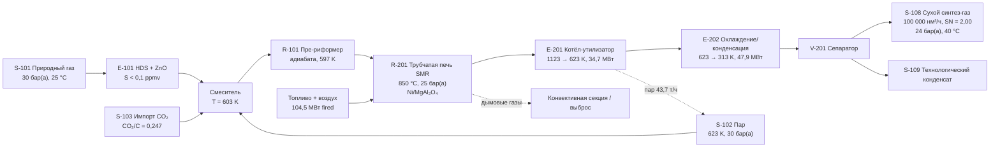

# PFD (технологическая схема, front-end)

Условные обозначения аппаратов соответствуют `docs/06_equipment.md`.
Потоки, не показанные численно в балансе, перечислены в `results/base_case_streams.csv`.
